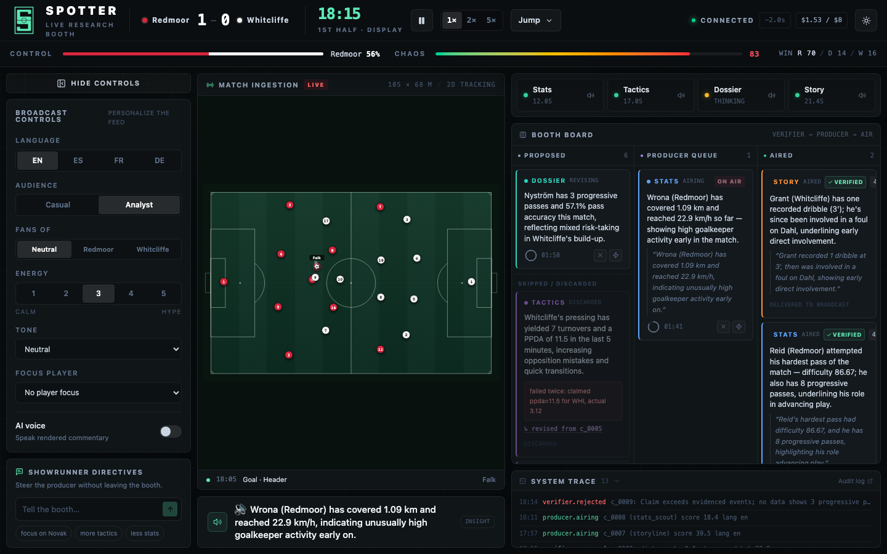
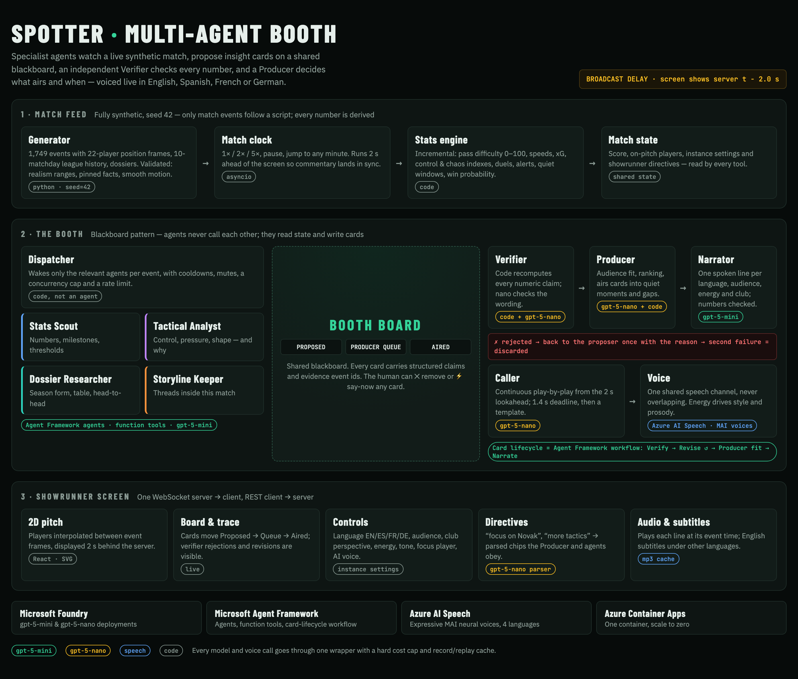

<p align="center"></p>

<h1 align="center">Spotter</h1>
<p align="center"><a href="https://github.com/George-Elhamy/spotter/actions/workflows/ci.yml"></a></p>
<p align="center"><b>An AI research booth for live football commentary.</b><br>
Your commentator covers one language. Spotter covers every market — and does the research for him.</p>



**Live demo:** https://spotter.salmonmoss-28211672.swedencentral.azurecontainerapps.io (scales to zero — the first visit can take ~20 s to wake up)

Built for **Microsoft x Premier League — Inside the Game: Developer Hackathon** · Category: **Best Multi-Agent System**.
All teams, players and stadiums are fictional; the match is fully synthetic.

---

## The problem

Commentators prep stacks of notes and still miss live insights, and many markets and languages get no commentary at all. In broadcasting a *spotter* feeds facts to the commentator. In Spotter, a team of AI agents is the spotter: it researches the match as it happens, checks every number, and either hands the human commentator verified notes or voices the commentary itself, in the audience's language.

## How it works



- **Blackboard pattern.** Agents never call each other. They read the match through tools and post insight cards to a shared **Booth Board**.
- **Event-driven, concurrent proposers.** A code **Dispatcher** wakes only the agents relevant to each event, with cooldowns, mutes and a concurrency cap.
- **Independent Verifier.** Code recomputes every numeric claim on a card against the stats engine and the season data; a small model checks the wording. A wrong number sends the card back to its agent for **one** revision; a second failure discards it — visibly, on the board.
- **Producer as orchestrator.** Decides whether a card fits the audience, ranks the queue, and airs cards into quiet moments and gaps in the play-by-play. The human showrunner steers it with plain-language directives.
- **Broadcast delay.** The backend runs 2 s ahead of what the screen shows, so the live play-by-play lands in sync with the pitch.
- **The card lifecycle is a Microsoft Agent Framework workflow:** Verify → (Revise ↺) → Producer fit → Narrate.

### The agents

| Agent | Model | Job | Reads (function tools) |
|---|---|---|---|
| **Stats Scout** | gpt-5-mini | Notable numbers, milestones, threshold crossings | player/team stats, match leaders, alerts |
| **Tactical Analyst** | gpt-5-mini | Shifts in control, pressure and shape — and *why* | control & chaos, period comparison, pressing, average shape, matchups |
| **Dossier Researcher** | gpt-5-mini | Context from outside the match | player & team dossiers, league table, head-to-head |
| **Storyline Keeper** | gpt-5-mini | Threads inside this match | key moments, duels, player timelines, aired history |
| **Verifier** | code + gpt-5-nano | Recomputes every number, checks wording, dedupes | stats engine, dossiers |
| **Producer** | gpt-5-nano + code | Audience fit, ranking, timing, directives | board, match state |
| **Narrator** | gpt-5-mini | Rewrites a card into one spoken line per language, audience, energy and club perspective — numbers must survive | card + settings |
| **Caller** | gpt-5-nano | Continuous play-by-play from the 2 s lookahead (1.4 s deadline, then a template) | upcoming events |

Every agent reads the board (`get_recent_cards`) so it does not repeat what was already said.

**Retrieval is tool calling, not vector RAG.** There are no embeddings and no vector store. Agents look up exact values in structured data — the live stats engine and the generated season dossiers — through typed function tools, so the Verifier can recompute every number they state.

### The five brief stages

| Stage | In Spotter |
|---|---|
| Ingest | Live event stream → match state, 2D pitch |
| Interpret | Stats engine: pass difficulty, speeds, xG, control & chaos indexes |
| Explain | Proposer agents write "why it matters" cards; the Verifier checks them |
| Render | Pitch, board, subtitles, synchronized voice |
| Personalize | Language (EN/ES/FR/DE), audience, club perspective, energy, tone, focus player, chat directives |

## Microsoft technologies used

- **Microsoft Foundry** — `gpt-5-mini` (proposers, Narrator) and `gpt-5-nano` (Verifier wording, Producer fit, Caller, directive parser) deployments.
- **Microsoft Agent Framework** (Python) — the four proposers are Agent Framework agents with function tools; the card lifecycle (verify → revise → fit → narrate) is an Agent Framework workflow (`WorkflowBuilder`, conditional edges).
- **Azure AI Speech** — expressive neural voices with energy-driven speaking styles: English (Harry), Spanish (Alejo), French (Marc), German (Klaus).
- **Azure Container Apps** — one container (FastAPI serves the API, WebSocket and the built frontend), scale to zero.

## Synthetic, validated data

Only the *match events* follow a script (goals, cards, VAR, the penalty, the red card, subs). Nothing about commentary is scripted — agents discover every insight from data.

- `backend/app/generator/` simulates the full match from a fixed seed (42): 1,749 events with 22-player position frames from formation slots, plus 10 previous matchdays, the league table and per-player dossiers. All aggregates are **derived** from generated lines, never typed in.
- `python -m app.generator.validate` asserts the score progression, every scripted beat, pinned season facts, realism ranges (passes, accuracy, shots, speeds, possession), positions inside the pitch, smooth motion, and no events from players off the pitch, then prints a realism report.

## Run it locally

Requirements: Python 3.11, Node 20+, an Azure OpenAI/Foundry deployment of `gpt-5-mini` and `gpt-5-nano`, an Azure AI Speech resource.

```bash
cp .env.example .env          # fill in your keys
# backend
cd backend && python3.11 -m venv .venv && .venv/bin/pip install -r requirements.txt
.venv/bin/uvicorn app.main:app --port 8000
# frontend (new terminal)
cd frontend && npm install && npm run dev      # http://localhost:5173
```

Or as one container: `docker build -t spotter . && docker run -p 8000:8000 --env-file .env spotter` → http://localhost:8000

| Variable | Purpose |
|---|---|
| `AZURE_OPENAI_ENDPOINT` / `AZURE_OPENAI_API_KEY` / `AZURE_OPENAI_API_VERSION` | Foundry / Azure OpenAI endpoint |
| `MODEL_MINI`, `MODEL_NANO` | Deployment names (default `gpt-5-mini`, `gpt-5-nano`) |
| `SPEECH_KEY`, `SPEECH_REGION` | Azure AI Speech |
| `VOICE_EN`, `VOICE_ES`, `VOICE_FR`, `VOICE_DE` | Voice per language |
| `CACHE_MODE` | `off` · `record` · `replay` (record/replay LLM outputs and audio) |
| `MAX_LLM_CALLS_PER_MIN` | Rate guard |
| `COST_CAP_USD` | Hard spend cap (default 8) |

Tests: `cd backend && .venv/bin/python -m pytest tests -q` · data validation: `.venv/bin/python -m app.generator.validate`

## Try it

Open the [live demo](https://spotter.salmonmoss-28211672.swedencentral.azurecontainerapps.io), pick a moment from **Jump**, then press ▶ after a jump — the booth opens with a scene-setting line and never starts silent.

- **17'** — Moretti keeps beating Whitaker; Falk's header at 18:05. Watch cards move Proposed → Queue → Aired.
- **37'** — Novak's through ball for Visser's equaliser.
- **60'** — the red card: Redmoor drop to a 4-4-1 and the Tactical Analyst explains the shift.
- **87'** — switch to **ES · Casual · Redmoor fans · energy 5**: Lindqvist's first league goal and the stoppage-time winner.
- Type **"focus on Novak"** or **"more tactics"** in the directive chat; ✕ remove a card or ⚡ say one now.

## Failure recovery and responsible AI

- **Verifier rejects** a wrong number → the agent revises once → otherwise the card is discarded (shown on the board and in the trace).
- **Caller misses its 1.4 s deadline** → a pre-generated template line in the same language.
- **Agent error or timeout** → status turns red, the Dispatcher backs off, other agents continue.
- **Card goes stale** → it expires instead of airing late.
- **Speech fails** → the line is shown as a subtitle.
- **Rate limit** → one retry, then the Producer falls back to code-only ranking.
- **Narrator changes a number** → retry, then fallback.
- **Cost cap reached** → every model and speech call stops, the UI shows a badge, templates and subtitles carry on.
- **The human stays in control**: remove or say-now any card, mute agents, steer with directives; every aired line is logged at `/api/audit`.

## Repository layout

```
backend/app/
  agents/      proposers, verifier, producer, narrator, caller, dispatcher, workflow (Agent Framework), prompts
  tools/       function tools the agents call
  stats/       incremental stats engine (pass difficulty, xG, control/chaos, alerts, quiet windows)
  generator/   synthetic match + season generator and validator
  data/        generated JSON (committed) and fallback templates
  llm.py       the single gateway for every model and speech call (cost cap, rate limit, cache)
frontend/src/  React + Vite + Tailwind: pitch, board, controls, audio
docs/          architecture diagram, screenshot, logo
```

## Roadmap

- Multiple simultaneous booth instances (one per language or market) sharing the same agents.
- More languages and voices.
- Adapters for real event and tracking feeds in place of the synthetic generator.

## License

MIT — see [LICENSE](LICENSE).
